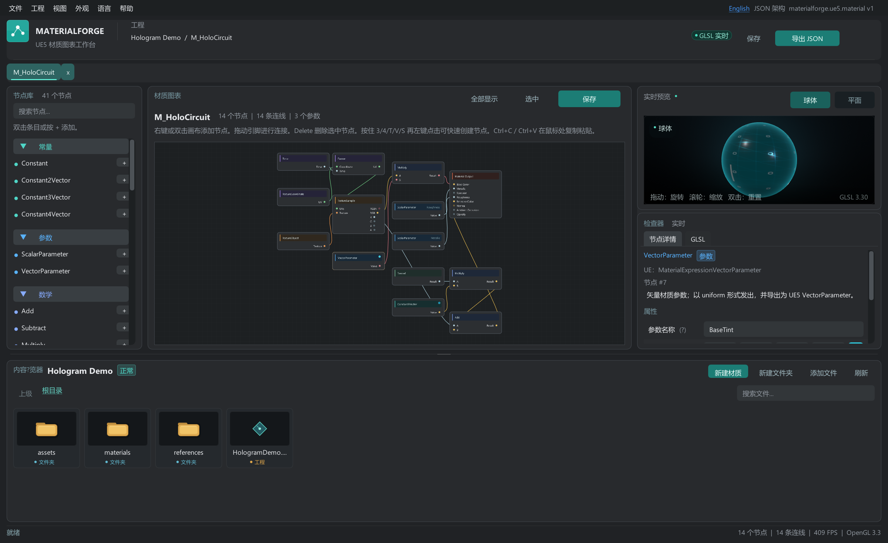
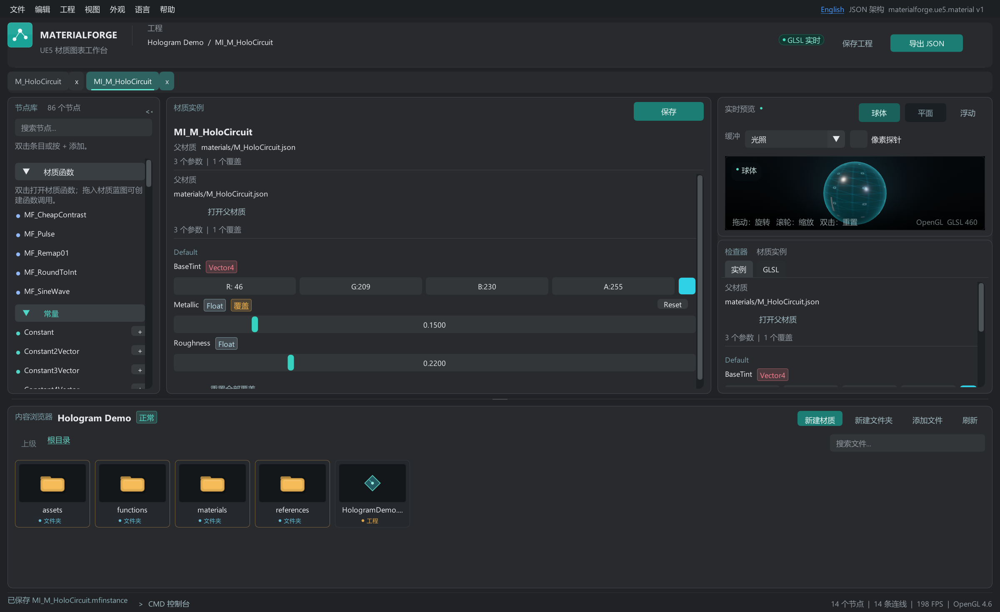
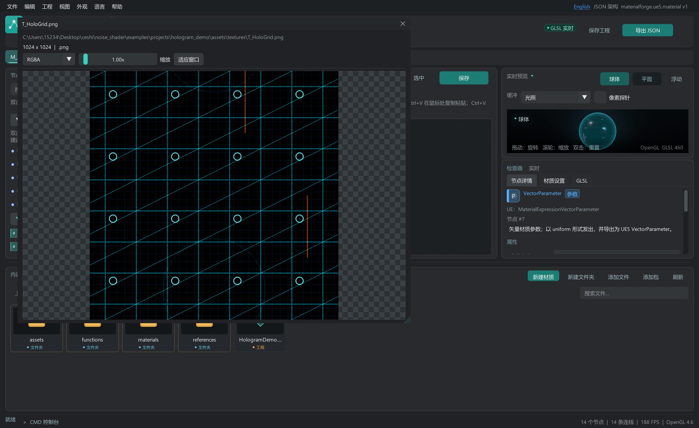
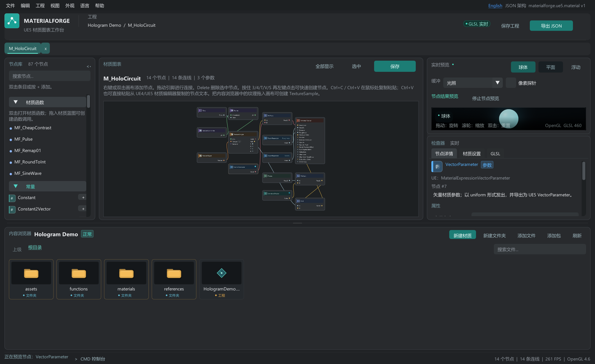
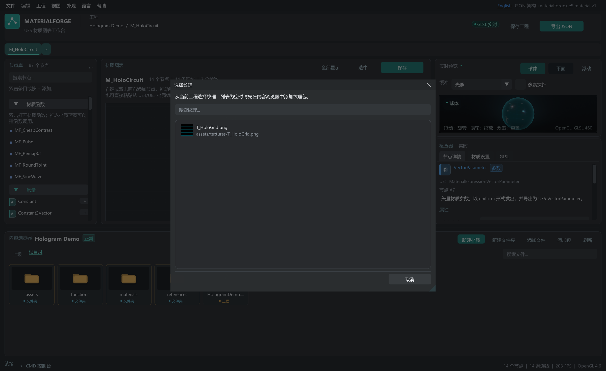

# MaterialForge

[](https://github.com/dragoncityzZZ/dgndx/releases/latest)
[](LICENSE)
[](https://github.com/dragoncityzZZ/dgndx/releases/latest)

**MaterialForge** 是一个独立的 Windows 桌面工具，用来创建、编辑和预览
**UE5 风格材质节点图**。它不依赖 Unreal Editor 运行：在节点画布中连接材质
表达式，程序会实时生成 GLSL 并在材质球或平面上预览，同时可以导出
`materialforge.ue5.material` JSON，再由 UE5 Python 桥接脚本重建为真实材质。

适合用来学习 UE 材质节点逻辑、快速试验材质效果、批量生成材质 JSON，或者
作为 UE5 材质工作流的离线草稿工具。

- 开源仓库：[dragoncityzZZ/dgndx](https://github.com/dragoncityzZZ/dgndx)
- 下载安装包：[Releases](https://github.com/dragoncityzZZ/dgndx/releases/latest)
- 当前版本：**2.5.0** · Windows x64 · 中文 / English
- 主要技术：C++17、Dear ImGui、imgui-node-editor、OpenGL / Vulkan / DX12

## 截图

| 材质节点编辑 | Material Instance |
|---|---|
|  |  |

| 纹理查看器 | 节点实时预览 |
|---|---|
|  |  |


---

## 功能

### 节点编辑

- 91 个 UE 对齐节点定义（87 个节点库可见），覆盖常量、参数、纹理、
  坐标、Panner / Rotator / Fresnel、数学、比较、分支、Noise 等常用节点。
- 材质函数、FunctionInput / FunctionOutput、函数调用、节点折叠和 Reroute。
- 节点 / 引脚 / 连线缩略图，向量引脚拆分，节点对齐、分布、分组、书签和注释框。
- `Ctrl+Z` / `Ctrl+Y` 撤销重做；dirty 文档自动保存，异常退出后可恢复。
- 复制/粘贴节点，支持 UE4 / UE5 材质编辑器复制文本直接粘贴到画布。
- 材质设置：Domain、Blend Mode、Shading Model、Two Sided、Opacity Mask Clip、
  16 个 Material Output 属性等。

### 内容浏览器与纹理

- UE5 Content Browser 风格瓦片文件栏：文件夹、材质、实例、函数、纹理、模型和
  工程文件均以卡片显示，支持面包屑、搜索、可调高度和最近工程。
- **Shift 范围多选 / Ctrl 点选**；多选文件右键可删除、移动、复制到目标文件夹，
  或批量创建副本。
- **添加包** 把内置纹理包（常量、检查器、渐变、噪声、图案、水、自然、特效等）
  复制到当前工程的 `textures/` 并登记到 `.mfproject`；内置资产打包在
  `assets/textures/`。
- TextureSample 的 Texture 输入支持从内容浏览器直接拖入；画布引脚、检查器
  引脚表和旁边的 `...` 按钮都能打开纹理选择器。
- 纹理选择器只列出当前工程已有纹理；没有添加包时不会凭空显示内置资产。
- **双击纹理**打开纹理查看器，支持缩放、平移、透明棋盘格以及
  RGBA / RGB / R / G / B / A 通道查看。




### 实时预览

- OpenGL 4.6（自动回退 4.3 / 3.3）、Vulkan、DirectX 12 三种预览后端。
- 球体 / 平面、可浮动预览窗口、Buffer Visualization、像素探针。
- 自定义预览网格、HDRI 环境、灯光强度、曝光、地面高度。
- **节点实时预览**：右键节点选择“实时预览”，或右键输出引脚选择“预览此输出”，
  材质球显示该节点及其上游子图的运算结果，修改上游节点后自动刷新。


### Material Instance

- 右键材质瓦片选择 **Create Material Instance...** 创建 `.mfinstance`。
- 参数支持分组、排序、描述、滑块范围和稀疏覆盖；实例文件不会修改父材质。
- **右键常量节点 → 转换为参数**，可把 Constant / Constant2Vector /
  Constant3Vector / Constant4Vector 转成 ScalarParameter / VectorParameter，
  并保留原有的下游连线。
- 创建实例后，实例标签页会显示转换出的参数；调值会实时写回父材质图并刷新
  预览，支持单项 Reset 和全部重置。
- 详见 [docs/PROJECT_FORMAT.md](docs/PROJECT_FORMAT.md) 和
  [docs/JSON_SCHEMA.md](docs/JSON_SCHEMA.md)。


### UE5 桥接

- 导出 `materialforge.ue5.material` JSON。
- `tools/ue5/import_material_graph.py` 在 UE5 中用
  `unreal.MaterialEditingLibrary` 重建材质、节点、连线、参数和材质属性。
- Push / Pull 支持批量同步，并保存 UE 路径与同步状态。

### MCP 服务器

- 默认关闭。在 **偏好设置 → MCP** 启用，监听
  `http://127.0.0.1:3011/mcp`（端口可改），仅绑定本机回环地址。
- 工具：`mf_status`、`mf_list_materials`、`mf_create_material`、
  `mf_get_graph`、`mf_set_graph`、`mf_add_node`、`mf_connect`、
  `mf_import_ue5_text`。
- 详见 [docs/MCP.md](docs/MCP.md)。

### 插件

- **编辑 → 插件管理器...**：添加、启用/禁用、重载、卸载插件。
- 插件是带 `plugin.json` 的 Windows DLL，通过 `MaterialForgePluginInit` 注册
  CMD 控制台命令。
- **创建插件...** 使用 Windows 原生文件夹选择器选择位置，生成
  `plugin.json`、CMakeLists、C++ 源码、公共头文件、README 和 API 文档。
- 详见 [docs/PLUGINS.md](docs/PLUGINS.md)。

---

## 安装 / 运行

### 安装程序

安装包生成在：

```text
dist/installer/MaterialForge-2.5.0-Setup.exe
```

运行安装程序后从开始菜单或桌面快捷方式启动。安装包包含程序、默认纹理、
示例工程、文档、UE5 工具和卸载程序。安装后 `{app}\unins000.exe` 和开始菜单
中的 **Uninstall MaterialForge** 都可以卸载，Windows“应用和功能”里也会登记。

也可以直接从 GitHub Releases 下载：

<https://github.com/dragoncityzZZ/dgndx/releases/latest>

### 从源码运行

```powershell
git clone https://github.com/dragoncityzZZ/dgndx.git
cd dgndx
cmake -S . -B build -G "Ninja" -DCMAKE_BUILD_TYPE=Debug
cmake --build build
.\build\bin\MaterialForge.exe
```

> **SmartScreen 提示**：未签名的安装包在其他机器上可能显示
> “Windows 已保护你的电脑 / 发布者未知”。这是 Windows 对下载文件的
> SmartScreen 检查，不是安装包缺少卸载程序。要让 SmartScreen 显示发布者，
> 需要用受信任的代码签名证书对 `MaterialForge.exe` 和
> `MaterialForge-2.5.0-Setup.exe` 签名。构建脚本支持 PFX 或证书指纹：
>
> ```powershell
> $env:MATERIALFORGE_SIGN_PFX = "C:\path\to\codesign.pfx"
> $env:MATERIALFORGE_SIGN_PASSWORD = "pfx-password"
> powershell -ExecutionPolicy Bypass -File .\scripts\build-installer.ps1
> ```
>
> 也可以设置 `MATERIALFORGE_SIGN_THUMBPRINT` 使用当前用户证书库中的证书。
> 没有受信任证书时，可以点“更多信息 → 仍要运行”继续安装；建议通过
> 内网文件共享 / U 盘分发，减少浏览器给安装包附加 Mark-of-the-Web 的机会。

### 卸载

安装器会在 `{app}\unins000.exe` 生成卸载程序，并创建开始菜单
**Uninstall MaterialForge** 快捷方式；也可以从 Windows“应用和功能”卸载。
用户配置和最近工程保存在 `%APPDATA%\MaterialForge`，卸载程序默认保留这些
用户数据；需要彻底清理时手动删除该目录。

### 便携版

```text
dist/MaterialForge-2.5.0-win64-portable/
├─ MaterialForge.exe
├─ assets/          # 默认纹理、模型、manifest
├─ examples/        # 示例材质图和工程
├─ docs/            # 使用与格式文档
├─ tools/           # UE5 / glslang 工具
├─ README.md
└─ THIRD_PARTY_NOTICES.md
```

直接双击 `MaterialForge.exe` 即可运行。Release 使用静态 MSVC 运行库和
Windows GUI 子系统，不依赖额外 VC++ Redistributable。

启动时默认是**空工作区**，不自动打开示例材质。打开已有工程、最近工程，
或新建材质后才会显示预览。

```powershell
# 打开示例工程
.\dist\MaterialForge-2.5.0-win64-portable\MaterialForge.exe `
  .\examples\projects\hologram_demo\HologramDemo.mfproject

# 打开单个材质
.\dist\MaterialForge-2.5.0-win64-portable\MaterialForge.exe `
  --open .\examples\graphs\hologram_circuit.json
```

### 从源码构建

依赖：Windows 10/11、CMake 3.21+、支持 C++17 的 MSVC。第三方库均已
vendored，首次构建不需要联网。

```powershell
cmake -S . -B build -G "Ninja" -DCMAKE_BUILD_TYPE=Debug
cmake --build build
ctest --test-dir build --output-on-failure
```

无控制台、静态运行库的 Release：

```powershell
cmake -S . -B build-release -G "Ninja" `
  -DCMAKE_BUILD_TYPE=Release `
  -DMF_STATIC_RUNTIME=ON `
  -DMF_WIN32_GUI=ON
cmake --build build-release --config Release
```

也可以使用 [scripts/package.ps1](scripts/package.ps1) 生成便携目录和 zip。
构建系统会把 `assets/`、`examples/`、`tools/` 复制到可执行文件旁边。

### 生成安装程序

需要安装 [Inno Setup 6](https://jrsoftware.org/isinfo.php)。推荐直接运行：

```powershell
powershell -ExecutionPolicy Bypass -File .\scripts\build-installer.ps1
```

脚本会把最新 Release、资源、示例、工具和文档暂存到
`build/installer-payload/`，再调用
[installer/MaterialForge.iss](installer/MaterialForge.iss)：

```powershell
& "C:\Program Files (x86)\Inno Setup 6\ISCC.exe" .\installer\MaterialForge.iss
```

输出：`dist/installer/MaterialForge-2.5.0-Setup.exe`。

---

## 常用操作

| 操作 | 效果 |
|---|---|
| 左键拖拽节点 / 引脚 | 移动节点 / 创建连接 |
| 右键画布或双击画布 | 可搜索的节点创建菜单 |
| `Delete` | 删除选中节点或连线（Material Output 受保护） |
| 滚轮 / 中键拖拽画布 | 缩放 / 平移 |
| 拖拽节点库行到画布 | 在投放位置创建节点 |
| `Ctrl+N` / `Ctrl+O` / `Ctrl+S` | 新建 / 打开 / 保存 |
| `Ctrl+Shift+S` / `Ctrl+E` | 另存为 / 导出 UE5 JSON |
| `Ctrl+C` / `Ctrl+V` | 复制节点 / 粘贴（支持 UE 复制文本） |
| `Ctrl+W` / `Ctrl+Tab` | 关闭当前标签 / 切换标签 |
| `Home` / `F` | Frame All / Frame Selection |
| `R` | 重置预览相机 |
| `Ctrl+,` | 偏好设置 |
| ``Ctrl+` `` | 显示 / 隐藏 CMD 控制台 |
| 内容浏览器 Shift + 点击 | 范围多选文件 |
| 双击纹理 | 打开纹理查看器 |
| 右键常量节点 | 转换为参数 |
| 右键节点 / 输出引脚 | 实时预览节点结果 |

节点库搜索支持多关键词和中文别名，例如 `vector parameter`、`向量 参数`。
Inspector 的 `GLSL` 标签可查看生成代码和编译日志。

---

## 工程与文件

- 工程文件：`.mfproject`，记录资源清单、主材质、文件夹颜色和最近打开时间。
- 工程目录通常包含 `materials/`、`assets/textures/`、`assets/models/`、
  `references/`、`functions/` 等。
- 材质文件：`.json`（`materialforge.ue5.material`）。
- 材质实例：`.mfinstance`（`materialforge.instance`）。
- 蓝图函数：`.mffunction`。
- 默认纹理清单：`assets/textures/default_texture_manifest.csv`。
- 构建产物、安装包和便携目录在 `build*/`、`dist/` 下，已被 `.gitignore` 忽略。

工程破损时仍会加载现有文件并列出缺失引用；补齐文件后点“刷新”。

---

## 目录结构

```text
src/
  app/       窗口、内容浏览器、节点画布、Inspector、插件、MCP
  core/      节点、引脚、图、参数、实例、类型系统
  codegen/   GLSL / HLSL 生成
  io/        JSON、纹理、UE 剪贴板
  project/   .mfproject、UE 同步
  render/    OpenGL / Vulkan / DX12 预览
assets/      默认纹理、模型、manifest
examples/    示例材质图和工程
docs/        架构、格式、节点参考、UE5 导入、MCP、插件
installer/   Inno Setup 安装脚本
tools/       UE5 Python 与 glslang 工具
tests/       核心、设置、UE 剪贴板、着色器测试
```

更详细的模块说明见 [docs/ARCHITECTURE.md](docs/ARCHITECTURE.md)。

---

## 测试

```powershell
ctest --test-dir build --output-on-failure
```

当前 4 个测试目标：

- `material_core`
- `shader_smoke`
- `app_settings`
- `ue5_clipboard`

测试覆盖节点 / 图序列化、GLSL 基础生成与真实编译、设置往返、UE5 剪贴板解析。

---

## 已知限制

- 当前主要在 Windows 11 + MSVC + OpenGL 4.6 上验证；Linux / macOS 保留分支但
  未作为发布目标。
- Vulkan / DX12 预览为可选后端，需要对应驱动；不满足时回退 OpenGL。
- 纹理参数在 Material Instance 中仍是只读元数据；标量 / 向量参数支持覆盖。
- 材质实例的父材质修改后需要在实例页重新打开或刷新参数列表。
- MCP 默认关闭，只监听本机回环地址。

---

## 文档

- [docs/ARCHITECTURE.md](docs/ARCHITECTURE.md) — 模块与数据流
- [docs/PROJECT_FORMAT.md](docs/PROJECT_FORMAT.md) — 工程、材质实例、资源清单
- [docs/JSON_SCHEMA.md](docs/JSON_SCHEMA.md) — 材质图 JSON 字段
- [docs/NODE_REFERENCE.md](docs/NODE_REFERENCE.md) — 节点参考
- [docs/UE5_IMPORT.md](docs/UE5_IMPORT.md) — UE5 Push / Pull 与 Python 桥接
- [docs/MCP.md](docs/MCP.md) — MCP 服务与工具
- [docs/PLUGINS.md](docs/PLUGINS.md) — 插件 ABI、目录格式和创建模板
- [docs/DEFAULT_TEXTURES.md](docs/DEFAULT_TEXTURES.md) — 内置纹理清单

## License

MIT License. 详见 [LICENSE](LICENSE)。第三方组件和资源的许可见
[THIRD_PARTY_NOTICES.md](THIRD_PARTY_NOTICES.md)。
