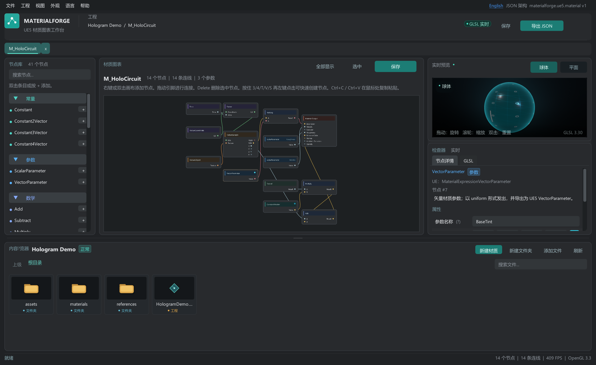

# MaterialForge Project Format

A MaterialForge project groups material documents, blueprint function assets,
texture files, model files, reference files, and a single portable load file
into one directory. Projects
are opened from **Project → Open Project...**, from **Project → Recent
Projects**, or from the bottom **Content Browser**.

## Project layout

A project created by MaterialForge looks like this:

```text
HologramDemo/
├─ HologramDemo.mfproject       # portable project load file (JSON)
├─ materials/
│  └─ M_HoloCircuit.json        # MaterialForge material graph
├─ MF_TintFunction.mffunction    # Reusable blueprint function graph
├─ assets/
│  ├─ textures/
│  │  └─ T_HoloGrid.png
│  └─ models/
│     └─ PreviewCube.obj
└─ references/
   └─ notes.txt
```

`New Project` immediately opens the native Windows folder picker for the parent
location, then asks for the project name in the application. The **Browse...**
button can change the location with the same native picker; the custom in-app
browser is used only on platforms without a native picker. MaterialForge creates
the project folder and these default directories only after the **Create
Project** action. Folder creation is disabled until a project is open.

`Project -> Open Project...` also uses the native Windows folder picker: select
a project folder and MaterialForge finds its `.mfproject` manifest. If several
manifests are present, the one whose name matches the folder is preferred,
otherwise the most recently modified manifest is opened.

Material and function documents both use the graph JSON schema
(`materialforge.ue5.material`). `.mffunction` files are identified by extension,
may contain `FunctionInput` / `FunctionOutput` nodes, and are not required to
contain a `MaterialOutput` node. Material documents should contain exactly one
`MaterialOutput`; the loader accepts function graphs with zero outputs so that
the same serializer can round-trip both document kinds.

Material graphs may contain `MaterialFunctionCall` nodes. Their `pins` array is
part of the document (input/output names, types and `default` values), so links
and editable constants can be restored without loading the `.mffunction` asset
first. The node properties store `functionPath` and `functionName`; the path is
resolved relative to the project root, the document folder, or the content root.

`Comment` nodes additionally store a `size` object (`x`, `y`) so resized comment
boxes and comment groups survive save/load. `Comment` has no pins and is ignored
by shader generation. `Reroute` nodes are ordinary wildcard pass-through nodes.

Function graphs store `pinType` on each `FunctionInput` / `FunctionOutput`
(`Float`, `Vector2`, `Vector3`, `Vector4`). `MaterialFunctionCall` nodes store
the generated input/output pins, including their types, so calls round-trip
without opening the function asset. `Collapse to Function` writes a new
`.mffunction` under the project `functions/` folder and replaces the selected
expressions with a call node.

Texture nodes (`TextureObject`, `TextureObjectParameter`,
`TextureSampleParameter2D`) and the `Sampler` node store `filter`, `addressU`,
`addressV`, `srgb`, `mipBias`, `maxAnisotropy`, and `textureGroup` properties.
Older documents without these fields use Linear / Repeat / sRGB defaults.

Material Instances use `.mfinstance` files with schema
`materialforge.instance` and version `1`. They contain a `parentMaterial` path
(project-relative when possible) and a `parameters` array of sparse overrides.
Each override has `name`, `type`, and `value`; the parent material graph is
never modified. Scalar/Vector parameter nodes carry `parameterGroup`,
`sortPriority`, `description`, `sliderMin`, and `sliderMax` metadata used by the
instance editor.

Split output pins are stored as additional output entries with `splitFrom`,
`splitIndex` and (for the hidden base pin) `hidden: true`. Loaders reconstruct
them before resolving links, so graphs using component pins remain portable.

The top-level `material` object also stores domain, blend/shading model,
translucency lighting mode, two-sided, dithered LOD, dynamic-shadow-as-masked,
emissive-for-static-lighting and `opacityMaskClip`. Material Output now writes
Opacity Mask, World Position Offset, Pixel Depth Offset, Refraction, Clear Coat,
Clear Coat Roughness, Subsurface Color and Anisotropy pins in addition to the
classic eight attributes.


## `.mfproject` manifest

The manifest is JSON with schema `materialforge.project`, version `1`:

```json
{
  "schema": "materialforge.project",
  "version": 1,
  "name": "Hologram Demo",
  "created": "2026-10-30T21:00:00",
  "lastOpened": "2026-10-30T21:00:00",
  "mainMaterial": "materials/M_HoloCircuit.json",
  "resources": [
    {
      "path": "assets/textures/T_HoloGrid.png",
      "kind": "texture",
      "required": true
    },
    {
      "path": "assets/models/PreviewCube.obj",
      "kind": "model",
      "required": true
    },
    {
      "path": "references/notes.txt",
      "kind": "text",
      "required": true
    }
  ]
}
```

Fields:

| Field | Meaning |
|---|---|
| `name` | Display name shown in the toolbar, title bar, and recent-project list. |
| `created` | ISO-8601 creation timestamp. |
| `lastOpened` | ISO-8601 timestamp updated when the manifest is saved. |
| `mainMaterial` | Project-relative path to the material graph loaded with the project. Required. |
| `resources` | Files explicitly imported with **Add File** or selected as project textures. |
| `resources[].path` | Project-relative path using forward slashes. Absolute paths and `..` escapes are rejected. |
| `resources[].kind` | `texture`, `model`, `material`, `function`, `text`, `shader`, or `file`. Informational only. |
| `resources[].required` | If `true` and the file is missing, the project is marked broken. |
| `folderColors` | Optional map of project-relative folder paths to `#RRGGBB` colors. Used by the Content Browser folder tint. |

The project file itself is never listed as a resource. All paths are stored
relative to the directory containing the `.mfproject` file, so moving or
renaming the whole project folder preserves its contents.

## Recent projects

Recent-project history is stored outside the project so that project folders
remain self-contained:

```text
%APPDATA%\MaterialForge\recent_projects.json       (Windows)
$XDG_CONFIG_HOME/MaterialForge/recent_projects.json (Linux)
~/Library/Application Support/MaterialForge/recent_projects.json (macOS)
```

Up to ten projects are kept, most recent first. The recent menu and the bottom
Content Browser both open projects through this list. Removing a recent entry never
touches the project on disk. Content Browser recent-project tiles open with a
single left click; the Project → Recent Projects menu also opens with one click.

## Broken projects

A project is **broken** when the manifest is readable but one or more marked
files cannot be found. Opening a broken project is intentionally non-fatal:

- The project window opens.
- The project name is shown with a red `BROKEN` badge in the toolbar and
  Content Browser.
- The Content Browser shows the number of missing references; click **Details** to
  list every missing marked path and the reason.
- If the main material still exists, it is loaded normally.
- If the main material is missing, a starter material is created in the editor
  with its document path set to the expected location. Saving it recreates the
  missing file.
- All other existing files remain browsable.

After restoring missing files or adding replacements, press **Refresh** in the
Content Browser to revalidate. The broken state clears automatically when all
required files are present again. A syntactically invalid manifest or an
unsupported schema version is different from a broken project: it is rejected
because there is no reliable project state to load.

## File operations

- **New Folder** creates a folder inside the current project directory. The
  project must be open; there is no way to create folders in arbitrary
  locations before project creation.
- **New Material** creates a starter `.json` material in the current project
  folder, opens it, and makes it the project's main material. If the file name
  already exists, the operation reports an error instead of overwriting it.
- Folder context menus provide **Rename Folder** and **Folder Color**; colors are
  persisted in `folderColors`. Folders and files can be dragged onto another
  folder to move them. Files also have **Rename File...**, **Move To...**,
  **Copy To...**, **Duplicate File**, and **Delete File...** actions. Renaming
  preserves the original extension; moving a file or folder updates resource
  paths, folder colors, UE sync keys, and any open document paths.
- **New Blueprint Function** creates a `.mffunction` graph with `Function Input`
  and `Function Output` nodes, records it as a `function` resource, and opens
  it in a new document tab. Function graphs share the node library and editor
  with materials but do not generate GLSL or a material preview.
- **Right-click empty space** in the bottom Content Browser opens a context menu
  with **New Folder...**, **New Material...**, and **New Blueprint Function...**.
  Right-clicking a file or folder tile does not open this creation menu.
- **Add File** copies a selected file into the current project directory and
  records it as a required resource. If a file with the same name exists,
  MaterialForge chooses a unique suffix. Models such as `.obj`, `.fbx`,
  `.gltf`, and `.glb` are recognized as `model` resources and copied into the
  project. They are stored and tracked, but this build does not render external
  models in the preview.
- **Drag files from Windows Explorer** onto the Content Browser to import them
  into the current project folder. Dropping outside the Content Browser or
  without an open project reports an error instead of copying. Texture tiles can
  then be dragged into the node canvas to create a connected `TextureObject` and
  `TextureSample`.
- **Double-click a folder** to browse it. **Double-click a material JSON** to
  load it as the project's main material. **Double-click a `.mffunction`** to
  open it in the function editor. The `.mfproject` row is also shown in the file
  list for transparency.
- Textures selected through a `TextureObject` node while a project is open are
  recorded as project resources. The preview resolves project-relative texture
  paths against the project root first, then falls back to the application
  content root.

The bundled example project is at
[examples/projects/hologram_demo/HologramDemo.mfproject](../examples/projects/hologram_demo/HologramDemo.mfproject).

Project names, folder names, and asset file names may use UTF-8, including
Chinese characters, spaces, and common symbols such as `# & @ ! + = ( ) [ ]`.
Windows-reserved characters (`\ / : * ? " < > |`) and device names (`CON`,
`NUL`, `COM1`, ...) are rejected with a localized reason. The new-folder and
new-material dialogs include a Paste button for clipboard/IME convenience.
The UI font merges a CJK fallback, project paths are handled through the native
wide filesystem API on Windows, and image files are decoded from memory so
Unicode directories work for textures too.



## Limitations

- Models are project assets only; this build does not import or render them.
- There is no drag-and-drop, rename, or delete action in the Content Browser
  yet. Creating materials and folders from the empty-space context menu is
  supported.
- The `.mfproject` extension is not registered with the operating system by the
  portable package. Use **Open Project** or pass the file to the executable.
- Project manifests do not embed asset data; keep the whole project folder
  together when moving a project.
